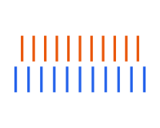

# Geometry library

Reusable alignment marks and wafer outlines for COMSOL and GDS drawings.
Each element has its own module in
[geompype/library](../geompype/library/__init__.py), installed with GeomPype.
Contributions are welcome: [add a geometry](#add-a-geometry).

## Alignment marks

The previews come from GDS geometry built by the library with default dimensions.
**Each thumbnail has its own scale**; the sizes shown on screen cannot be used
to compare physical dimensions. Blue represents the reference layer; orange
represents the moving layer of the vernier.

| Preview | Element and source file | Geometry, local coordinates and result |
| --- | --- | --- |
|  | [x_diamond_mark](../geompype/library/x_diamond_mark.py) | X and four diamonds with sampled corners, centred at (0, 0). Fixed dimensions: 175.092 × 175.092 µm. A `Union` of five polygons. |
|  | [cross_mark](../geompype/library/cross_mark.py) | Plus-shaped cross centred at (0, 0), with total span `size=100` µm and arm width `width=10` µm. A `Polygon`. |
|  | [l_mark](../geompype/library/l_mark.py) | L with outer side `size=100` µm and arm width `width=10` µm. Outer corner at (0, 0), with arms along +x and +y. A `Polygon`. |
|  | [box_mark](../geompype/library/box_mark.py) | Square frame centred at (0, 0), with outer side `size=100` µm and wall thickness `width=10` µm. A `Difference` of two `Square` objects, with a real hole. |
|  | [vernier_mark](../geompype/library/vernier_mark.py) | Two rows of 11 ticks on separate layers, with their central ticks aligned at x=0. A `Component` that places the pair together. |

The `size` and `width` dimensions of crosses, L marks and frames accept live
parameters. Crosses and L marks require `0 < width < size`; frames require
`0 < 2*width < size`. Call `build()` after changing a value.
Two differently sized frames, centred on separate layers, form a box-in-box
mark. This arrangement appears in
[examples/example_library_marks.py](../examples/example_library_marks.py).

The X/diamond mark is the only catalogue element loaded from fixed coordinate
data. Its coordinates come from
[x_diamond_mark.json](../geompype/library/data/x_diamond_mark.json)
and are described in the [asset documentation](library-data.md).

### Two-layer vernier

Create a vernier with
`vernier_mark(project, reference_layer=..., moving_layer=..., pitch=10,
resolution=1, ticks=11, width=2, length=20, gap=4, selections=())`.
The preview uses these defaults.

The layers must be distinct and belong to the same WorkPlane.
`ticks` is a fixed odd integer of at least three; the other dimensions are
lengths in µm and may be parameterised. The reference row is below y=0 and
the moving row is above it, separated by `gap`. Their pitches are `pitch`
and `pitch-resolution`, respectively. The central ticks align at x=0.
When ticks with the same index i coincide, the moving layer is displaced by
`i*resolution` towards +x. Indices increase from left to right. The indexed
range is ±`((ticks-1)/2)*resolution`.
The readout increment does not guarantee the instrument's measurement accuracy.

The result exposes `geometry['reference']` and `geometry['moving']`.
Use `.move((x, y))` to move the whole pair and `.rotate(90)` for a vernier
along y. Supplied selections include both rows.

## Wafer outlines


One preview represents this family: `three_inch_wafer(..., flats=2)`, using
its default dimensions. All three functions produce a filled `Polygon` with
one or two configurable flats.

| Function and source file | Nominal diameter | Primary flat | Secondary flat |
| --- | ---: | ---: | ---: |
| [two_inch_wafer](../geompype/library/two_inch_wafer.py) | 50 800 µm | 15 880 µm | 8 000 µm |
| [three_inch_wafer](../geompype/library/three_inch_wafer.py) | 76 200 µm | 22 220 µm | 11 180 µm |
| [four_inch_wafer](../geompype/library/four_inch_wafer.py) | 100 000 µm | 32 500 µm | 18 000 µm |

All three wafer functions share this signature:
`(project, *, layer, flats=1, flat_length=..., secondary_flat_length=...,
secondary_flat_angle=90, tolerance=1.0, selections=())`.

The four-inch designation refers here to a nominal diameter of **100 mm**.
These drawing dimensions come from
[supplier specifications](https://pgo-tech.com/silicon-wafer/); they do not
certify dimensional compliance. Flat lengths can be changed at construction;
each function fixes its nominal diameter.
The circle is centred at (0, 0), with the primary flat at the top and its
outward normal along +y. `flats=2` adds the second flat; its angle is measured
anticlockwise from +y. A value of 90 therefore places its normal along -x.
This angle implies no crystal orientation or doping convention.

Flat lengths describe the circle's chords before cutting. Two intersecting
cuts may shorten the final edges; both flats must remain visible. A zero
angle, or a cut completely hidden by the other cut, is rejected.
With `flats=1`, `flat_length=0` draws the full disk. `tolerance=1.0` limits
chord error to 1 µm before rounding to the GDS grid. COMSOL receives the same
polygonal outline.

Wafer construction arguments are fixed numbers; they do not accept `Parameter`.
Their `scale`, `move`, `rotate` and `array` transformations accept the usual
parameters. Wafers are filled planar footprints, without thickness or automatic
chip placement.

## Use a library element

Functions are available from `geompype.library` or directly from `geompype`.
All geometries follow their layer's WorkPlane, COMSOL/GDS flags and the
supplied selections.

```python
from geompype import Project, Parameter
from geompype.library import cross_mark, three_inch_wafer

project = Project(output='output/library')
reference = project.add_layer('wafer', gds_layer=100, comsol=False)
marks = project.add_layer('alignment', gds_layer=1, comsol=False)
wafer = three_inch_wafer(project, layer=reference, flats=2)
width = Parameter(10, 'mark_width', unit='um')
mark = cross_mark(project, layer=marks, size=100, width=width)
placed_mark = mark.rotate(angle=45).move(delta=(1000, 2000))
project.build()
```

This example generates GDS without a COMSOL server. To also create a layer's
geometry in COMSOL, set `comsol=True` and follow the
[server configuration guide](COMSOL_CONFIGURATION.md).

The demonstration scripts let you change parameters and view the geometries
in the installed applications:

- [Alignment marks](../examples/example_library_marks.py): X/diamonds, crosses,
  L marks, nested frames and x/y verniers.
- [Wafers](../examples/example_library_wafers.py): all three diameters, each
  with one or two flats.
- [Wafer and marks](../examples/example_library.py): four X/diamond marks
  placed on a two-inch wafer.

## Add a geometry

A contribution starts with a small, ordinary module and an example that is easy
to modify. [box_mark.py](../geompype/library/box_mark.py) and
[three_inch_wafer.py](../geompype/library/three_inch_wafer.py) show two existing
elements. New assemblies can use GeomPype's public primitives, transformations
and operations.

1. Add `geompype/library/your_mark.py`, with an explicit function and named
   parameters. Document units, local coordinates, dimensions, return type,
   constraints and which dimensions accept parameters.
2. Export the function from the [library module](../geompype/library/__init__.py)
   and [top-level package](../geompype/__init__.py), including their `__all__` lists.
3. Add or extend a flat script in `examples/`, with `# %%` cells, editable
   parameters, construction and display.
4. Check the geometry against dimensions, areas or boundaries calculated
   independently of its implementation. Cover parameters and rebuilds where
   supported. The [contribution guide](contributing.md) describes offline
   and native checks.
5. Add the element and its preview to this catalogue. Update
   [tools/render_library_catalogue.py](../tools/render_library_catalogue.py),
   then regenerate the images from the repository root using the project
   environment's interpreter:

   ```text
   python tools/render_library_catalogue.py
   ```

SVG previews are stored in `docs/images/library/`. Their generator uses the
project's existing dependencies and does not require COMSOL.
Personal recipes stay in their separate packages; this library contains
reusable public geometries.
